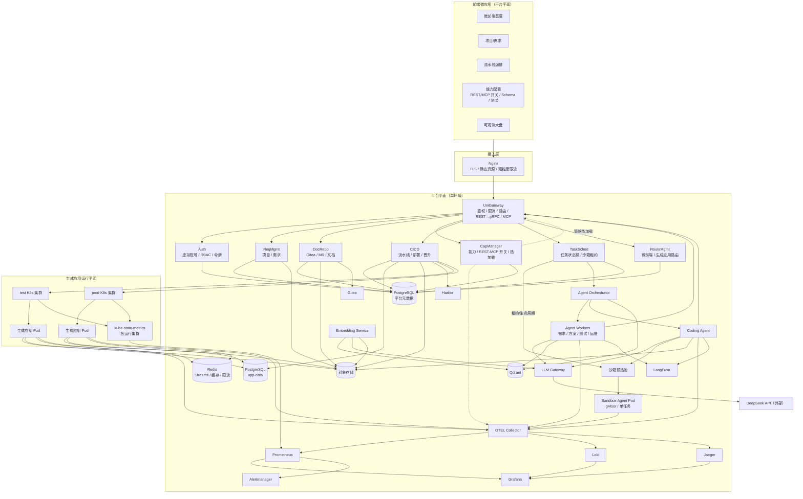
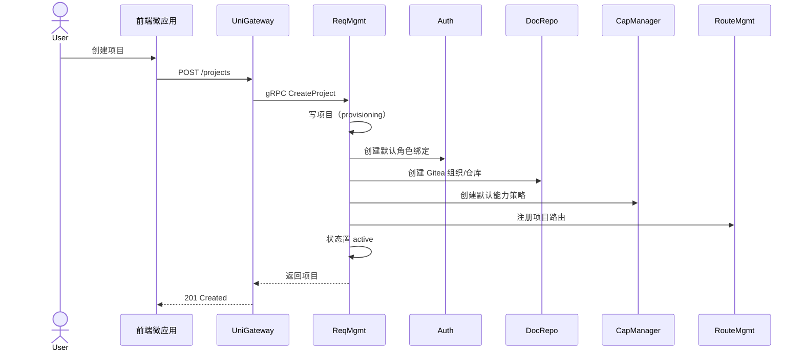
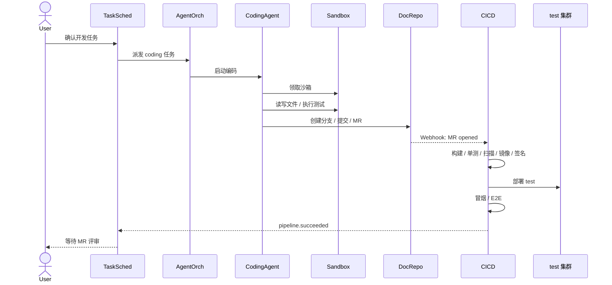
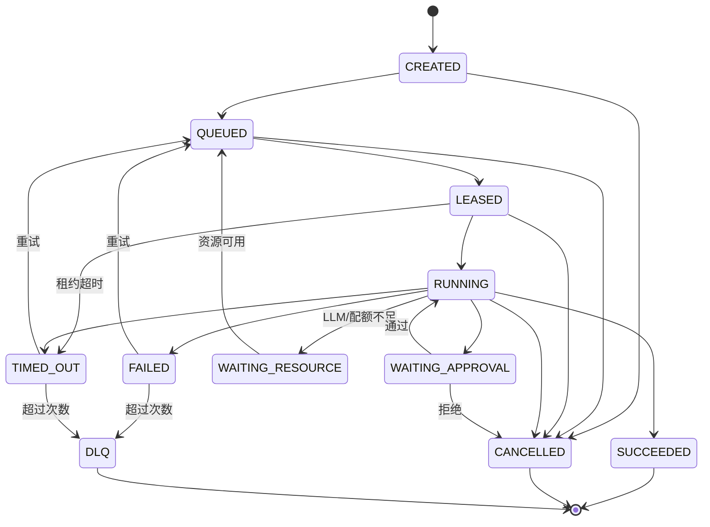
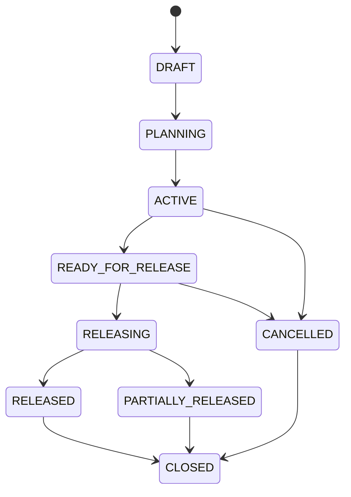
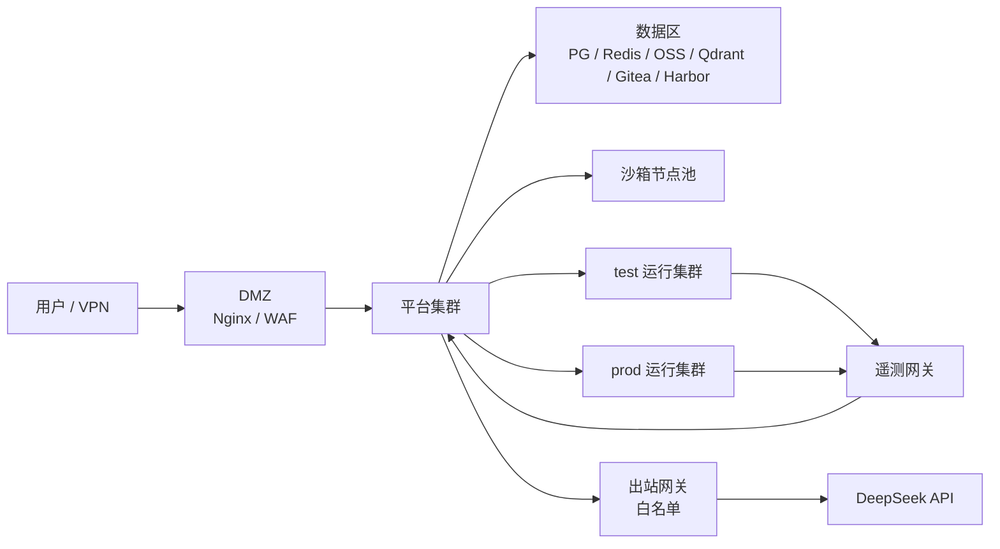

# AI DevOps 平台总体设计方案

> 版本：v0.1（评审稿）  
> 日期：2026-10-23  
> 状态：待评审  
> 范围：平台总体架构、核心服务、Agent 层、生成应用运行平面、非功能设计与实施路线  
> 配套需求：[AI DevOps 平台需求规格说明书](2026-10-23-ai-devops-platform-requirements.md)

---

## 0. 结论摘要

- **平台定位**：以 AI Agent 为核心的全链路软件交付基座，覆盖需求分析 → 方案设计 → 代码开发 → 自动化测试 → 制品构建 → 部署发布 → 应用运维，并支持已生成应用的增量迭代；区别于 Coze、Multica 等应用搭建器。
- **平台自身只部署一套环境**；test / prod 是 AI 生成应用的运行环境，不是平台的双环境。
- 平台采用**领域微服务**：8 个 Go 服务独立部署、独立数据库，服务间使用 gRPC + 事件驱动。
- Agent 层独立部署，包含编排、四类业务 Agent、Coding Agent、Embedding 与 LLM Gateway；沙箱运行在平台集群的独立节点池。
- 能力仅纳管**平台内置 API**，通过 `enable_rest` / `enable_mcp` 双开关控制；MCP 由 UniGateway 统一暴露并支持策略热加载。
- 用户使用平台发放的**虚拟账号，一人一号**；Gitea / K8s / LLM 等底层凭据由平台托管；不做企业 SSO 和强多租户，按项目做 RBAC 与审计。
- Agent **半自动**：可提交分支与 MR、自动部署 test；prod 晋升必须人工审批；沙箱不持有 prod 凭据。
- LLM 默认调用 DeepSeek 外部 API，但必须经 LLM Gateway 脱敏、审计、限额；接入层可插拔。
- 生成应用复用平台 `app-data` 数据服务，按“应用 + 环境”做逻辑隔离；`app-data` 与平台元数据**物理分库**，避免平台升级影响生成应用。
- 首期交付一条端到端链路：需求 → 分析/方案 → Coding Agent → MR → test 部署 → 观测 → 人工审批 → prod 晋升。

---

## 1. 背景、目标与约束

### 1.1 背景

平台以 AI Agent 为核心完成需求分析、方案设计、测试生成、编码、构建、部署与运维诊断，并支持对已生成应用发起增量迭代。平台自身是基座，所有 AI 生成应用统一通过平台域名体系对外访问；前端采用微前端架构，平台为主基座，各业务模块作为独立微应用接入。平台同时提供能力配置、MCP 工具暴露、可观测与审计能力。

与 Coze、Multica 等应用搭建平台的区别：本平台不只生成应用，而是绑定完整、标准化的软件工程交付流水线，覆盖生成、交付与持续迭代。

原架构图给出的是逻辑架构。本方案对其进行两处关键修订：

1. **平台平面与生成应用运行平面分离**。平台自身单环境；test / prod 只属于生成应用。
2. **存储按用途分层**。平台元数据与生成应用数据分库，避免平台运维动作影响生成应用。

### 1.2 设计目标

| 目标 | 说明 |
|---|---|
| AI 驱动全链路 | 需求、方案、编码、测试、构建、部署、运维均由 Agent 驱动；人保留审批与例外处置 |
| 端到端可用 | 需求、方案、编码、测试、部署、观测、晋升形成闭环 |
| 按迭代交付 | 需求归入项目迭代；按迭代生成应用级发布项，支持部分失败、重试与逐项回滚 |
| 增量迭代 | 已生成应用可持续接收变更需求，完成影响分析、增量开发、回归与再发布 |
| 统一接入 | 生成应用统一域名访问；前端微应用统一基座接入 |
| 收敛可控 | 不做企业 SSO、强多租户、任意外部能力接入、Agent 全自动发布 |
| 可演进 | 微服务边界清晰，后续可按负载拆分或合并；能力、模型、数据源均可替换 |
| 可运营 | 全链路可观测、可审计、可回滚、可限流、可降级 |
| 安全可控 | 虚拟账号、最小权限、沙箱隔离、人工审批、供应链签名 |

### 1.3 关键约束与假设

| 维度 | 约束 / 假设 |
|---|---|
| 用户与账号 | 平台自建虚拟账号，一人一号；底层系统凭据由平台托管；不做企业 SSO、不做强多租户 |
| 环境 | 平台单环境；生成应用使用 test、prod 两套独立 K8s 集群 |
| Agent 权限 | 半自动：分支/MR、test 自动部署；prod 晋升人工审批；沙箱无 prod 凭据 |
| 迭代模式 | 首次生成与后续增量迭代共用同一条交付流水线；增量变更必须做影响分析与回归 |
| LLM | 允许调用外部 DeepSeek API；必须脱敏、审计、限额；LLM Gateway 可插拔 |
| 能力来源 | 仅平台内置 API；不接第三方 API，不做服务自动注册 |
| 代码仓与文档 | 仅 Gitea；文档由平台自管，存 OSS / PostgreSQL |
| 规模 | 未锁定；按可横向扩展设计。基线：100 用户、20 并发 Agent 任务、30 并发沙箱；SLA 99.5% |
| 部署 | 私有云 / 自建 K8s + containerd；对象存储按 S3 兼容实现，默认 MinIO |
| 团队与周期 | 按 6–8 人团队估算；MVP（Phase 0–3）约 3–5 个月，完整 hardening 约 4–6 个月，可按实际调整 |

### 1.4 明确不做

- 企业 SSO / LDAP / 统一身份对接。
- 强多租户（独立计费、独立网络、独立集群）。
- GitHub / GitLab / Confluence / 飞书等外部连接器。
- 任意外部 REST 服务注册为 MCP 工具。
- Agent 自动合并、自动发布 prod。
- 多地域、多活、跨云容灾。
- 生成应用自带基础设施（数据库、缓存、网关由平台统一提供）。
- 平台自身的 test / prod 双环境复制；平台升级用金丝雀 + 快速回滚。

### 1.5 术语

| 术语 | 含义 |
|---|---|
| 平台平面 | 平台自身所在的单套运行环境，含 Go 微服务、Agent、沙箱、平台数据与可观测 |
| 生成应用运行平面 | 承载 AI 生成业务应用的 test / prod 两套独立 K8s 集群 |
| 前端微应用 | 平台 UI 的 4 个子应用：项目/需求、流水线编排、能力配置、可观测大盘 |
| 生成应用 | AI 生成并部署到 test / prod 的业务应用，不指前端微应用；统一通过平台域名体系访问 |
| 增量迭代 | 对已生成应用发起变更需求，经影响分析、增量编码、回归测试后再次发布 |
| 能力 | 平台内置 API 的元数据描述；可同时以 REST 与 MCP 形式暴露 |
| 任务 | TaskSched 管理的一次 Agent 或流水线工作单元 |
| 流水线 | CICD 管理的构建、测试、部署、晋升编排 |
| 晋升 | 把已通过 test 验证的镜像 digest 部署到 prod 的受控动作 |
| 沙箱 | 隔离执行 Agent 命令与测试的临时 Pod |
| 项目 | 需求、代码、生成应用、成员与权限的归属单元 |

---

## 2. 总体架构

### 2.1 两个平面

| 平面 | 承载内容 | 环境 | 故障影响 |
|---|---|---|---|
| **平台平面** | Nginx、8 个 Go 服务、Agent 层、沙箱池、平台元数据、可观测、Gitea、Harbor | 单套 | 控制面故障影响 UI/Agent/发布/观测；数据面（app-data/Redis/OSS）故障会影响生成应用 |
| **生成应用运行平面** | 生成应用 Pod、Ingress、命名空间、kube-state-metrics | test / prod 两套独立集群 | 单环境故障只影响该环境应用 |

平台平面内部再分控制面与数据面：Go 服务、Agent 为控制面；PostgreSQL、Redis、OSS、Qdrant、Gitea、Harbor 为数据面。生成应用的 `app-data` 与平台元数据分库，形成独立的故障域。

### 2.2 逻辑架构图



### 2.3 部署单元清单

| 类型 | 部署单元 | 副本 / 伸缩 | 说明 |
|---|---|---|---|
| 接入 | Nginx | ≥2，按连接数扩容 | TLS、静态资源、粗粒度限流、反向代理 |
| Go 服务 | UniGateway | ≥2，HPA | 无状态；JWT、限流、MCP |
| Go 服务 | Auth | ≥2，HPA | 账号、RBAC、令牌、审计 |
| Go 服务 | ReqMgmt | ≥2，HPA | 项目、需求、附件 |
| Go 服务 | DocRepo | ≥2，HPA | Gitea、MR、文档 |
| Go 服务 | CapManager | ≥2 | 能力目录、策略、热加载 |
| Go 服务 | CICD | ≥2，Worker 按队列扩容 | 流水线、构建、部署、晋升 |
| Go 服务 | TaskSched | ≥2，Worker 按队列扩容 | 任务状态机、沙箱租约 |
| Go 服务 | RouteMgmt | ≥2 | 前端微应用与生成应用路由 |
| Agent | agent-orchestrator | ≥2 | LangGraph 工作流与检查点 |
| Agent | agent-workers | KEDA 按队列深度 | 需求/方案/测试/运维四类队列 |
| Agent | coding-agent | KEDA 按队列深度 | 代码修改、MR、测试 |
| Agent | embedding-service | KEDA 按积压 | 分块、向量化、写入 Qdrant |
| Agent | llm-gateway | ≥2，HPA | 模型路由、脱敏、限额、观测 |
| 沙箱 | 沙箱预热池 | 按并发 | 预热 Pod，任务结束销毁 |
| 数据 | CloudNativePG（元数据） | 3 实例 | 8 个 database，按服务隔离 |
| 数据 | CloudNativePG（app-data） | 3 实例 | 生成应用数据，独立故障域 |
| 数据 | Redis | Sentinel / Cluster | Streams、缓存、限流、会话 |
| 数据 | MinIO | 分布式 | 制品、文档、备份、审计归档 |
| 数据 | Qdrant | 副本 / 分片 | RAG 向量库 |
| 数据 | Gitea | 1 主 + 备份 | 唯一代码仓 |
| 数据 | Harbor | ≥2 | 镜像、SBOM、签名 |
| 可观测 | OTEL Collector | DaemonSet + Gateway | 两平面采集 |
| 可观测 | Prometheus / Loki / Jaeger / Grafana / Alertmanager | 按保留期与容量 | 平台统一观测 |
| 可观测 | LangFuse | ≥2 | LLM 调用观测与评测 |
| 前端 | 基座 + 4 个微应用 | 静态多副本 | 独立构建、独立发布 |
| 运行面 | test / prod K8s 集群 | 各 1 套 | 生成应用运行；含 ingress、OTEL、kube-state-metrics |
| 交付 | Argo CD | 平台平面 | 管理 test / prod 的 GitOps 部署 |

### 2.4 与原架构图的映射与差异

**一致项（原图语义保留）**

| 原图元素 | 本方案位置 | 说明 |
|---|---|---|
| 客户端 4 个子应用 + 微前端基座 | 前端微应用，平台平面 | 名称细化为“前端微应用”，避免与“生成应用”混淆 |
| Nginx 接入网关 | 平台接入层 | 增加 WAF / TLS / 静态资源 |
| GoCore 8 个服务 | 8 个独立 Go 微服务 | 职责与名称保留；部署形态改为独立服务 |
| PostgreSQL / Redis / OSS / Gitea / Qdrant | 平台数据面 | 全部保留；PostgreSQL 拆为元数据与 app-data |
| 可观测 7 件套 | 平台平面 | 全部保留；统一采集两平面 |
| CapManager 双开关 + 热加载 | 6.2 / 6.5 | 语义保持一致 |
| CodingAgent → UniGateway | 保留 | Agent 经统一网关调能力 |
| 发布链路 | 保留 | 代码提交 → test 验证 → 晋升 prod |

**有意调整项（需评审确认）**

| 原图元素 | 文档处理 | 原因 |
|---|---|---|
| test / prod 环境注 | 平台单环境；test / prod 只属于生成应用 | 按用户澄清修正，避免复制平台 |
| Nginx → GoCore 整体 | Nginx → UniGateway → 各服务 | 统一鉴权、限流、路由；内部服务不直接暴露 |
| AIBusinessPod 与 Sandbox 同在 K8s runtime | AIBusinessPod → 生成应用运行平面；Sandbox → 平台平面 | 故障域、权限与伸缩特征不同 |
| App3 → CapManager 直连 | App3 → Nginx → UniGateway → CapManager | 统一鉴权、限流、审计；不暴露内部服务 |
| AgentLayer → Storage 泛化箭头 | Agent 仅直连 Qdrant / OSS（scoped）；Gitea 经 DocRepo；Postgres 禁止直连 | 最小权限与数据所有权 |
| 四个 Agent 独立节点 | 合并为 agent-workers，逻辑角色保留 | 降低首期部署单元数量 |
| DeepSeekAPI 在 Agent 层 | 外部服务，经 LLM Gateway | 脱敏、审计、限额、可插拔 |
| K8s runtime containerd | 普通 Pod 使用 containerd；沙箱使用 gVisor runtimeClass | 强隔离；仍由 containerd 调度 |
| 原图未体现的交付组件 | 新增 Harbor、Argo CD、LLM Gateway、app-data PG、agent DB、KEDA、Kyverno、Sealed Secrets、OIDC Provider、统一域名、增量迭代 | 支撑供应链、部署、隔离与持续迭代 |

**图示补强项（原图有、文档正文有，2.2 图已补齐）**

| 元素 | 处理 |
|---|---|
| kube-state-metrics | 2.2 增加运行面节点，连到平台 Prometheus |
| DeepSeek API | 2.2 增加外部节点，LLM Gateway 单向连出 |
| CapManager → UniGateway 热加载 | 2.2 增加虚线 |
| CapManager → OTEL | 2.2 增加虚线 |
| Sandbox / 生成应用 → OTEL | 2.2 增加显式边 |

**结论**：核心组件与主链路一致；差异集中在环境模型、运行时平面拆分、Agent 存储访问收敛、入口统一，以及为落地补齐的交付组件。这些差异不改变原图的业务语义，但会改变部署与权限边界，需在评审中确认。

### 2.5 关键架构决策（ADR 摘要）

| ADR | 决策 | 理由 | 代价 |
|---|---|---|---|
| ADR-001 | 平台单环境；test/prod 只属于生成应用 | 符合实际使用方式，避免复制整套平台 | 平台升级依赖金丝雀与回滚 |
| ADR-002 | 领域微服务，8 个 Go 服务独立部署 | 独立伸缩、故障隔离、团队并行 | 分布式治理与运维成本上升 |
| ADR-003 | database-per-service；元数据与 app-data 分库 | 边界清晰；隔离平台与生成应用故障域 | 连接数、迁移、备份复杂度上升 |
| ADR-004 | Redis Streams + Outbox，不引入 Kafka | 收敛中间件；满足当前规模 | 超大吞吐时需迁移 |
| ADR-005 | Gitea 为唯一代码仓；文档存 OSS/PostgreSQL | 收敛接入面 | 无外部仓连接器 |
| ADR-006 | 能力仅平台内置；REST/MCP 双开关 | 可控、可审计 | 扩展能力需发版 |
| ADR-007 | 外部 DeepSeek 经 LLM Gateway 脱敏审计 | 满足数据边界与可观测 | 增加一跳与运维组件 |
| ADR-008 | Agent 半自动；prod 人工审批 | 控制爆炸半径 | 发布效率低于全自动 |
| ADR-009 | 前端 qiankun 微前端 | 独立发布、技术栈兼容 | 基座与子应用版本兼容成本 |
| ADR-010 | MVP 不引入服务网格 | 降低复杂度 | mTLS/流量治理能力较弱 |
| ADR-011 | 生成应用用 Argo CD GitOps | 审计、漂移检测、回滚 | 增加 Argo CD 运维 |
| ADR-012 | 沙箱使用 gVisor | 强隔离，防逃逸 | 启动开销、兼容性限制 |

---

## 3. 平台核心服务设计

### 3.1 服务边界总表

| 服务 | 核心职责 | 数据 | 同步接口 | 主要事件 | 伸缩 |
|---|---|---|---|---|---|
| UniGateway | 南北向入口、JWT、限流、路由、MCP | 无业务库 | REST / SSE / MCP | 审计事件 | HPA |
| Auth | 虚拟账号、RBAC、令牌、审计 | `auth` | gRPC / OIDC | user.*, role.*, audit.* | HPA |
| ReqMgmt | 项目、需求、验收、附件、迭代与需求范围 | `req` + OSS | gRPC | project.*, requirement.*, iteration.* | HPA |
| DocRepo | Gitea、MR、文档、RAG 事件 | `docrepo` + OSS | gRPC | repo.*, mr.*, doc.* | HPA |
| CapManager | 能力目录、Schema、策略 | `cap` | gRPC | capability.* | 双副本 |
| CICD | 流水线、构建、部署、晋升、批次发布 | `cicd` + OSS + Harbor | gRPC | pipeline.*, deployment.*, promotion.*, release.* | Worker 扩容 |
| TaskSched | 任务状态机、队列、沙箱租约 | `task` + Redis | gRPC | task.*, sandbox.* | Worker 扩容 |
| RouteMgmt | 前端微应用与生成应用路由 | `route` | gRPC | route.* | 双副本 |

### 3.2 UniGateway

**定位**：唯一的南北向业务入口，不做业务逻辑。

- 校验用户 JWT（本地 JWKS 缓存 + Redis 吊销名单），注入用户、项目、角色、trace_id。
- 按用户 / 项目 / IP / 能力维度限流；请求体大小、超时、并发上限。
- REST ↔ gRPC 转换；SSE / WebSocket 透传；统一错误模型与错误码。
- MCP Server：`initialize`、`tools/list`、`tools/call`、取消；工具清单按令牌 scope 过滤。
- 幂等键校验、审计埋点、敏感字段脱敏、响应大小限制。
- 能力策略热加载：订阅 CapManager 事件，原子切换，保留 last-known-good。

**失败模式**：UniGateway 故障时平台 API/UI 不可用，生成应用继续服务；多副本 + HPA；Redis 不可用时降级为本地限流与短 TTL 缓存。

### 3.3 Auth

**定位**：虚拟账号与权限的唯一事实源。

- 账号：用户名 + 密码（Argon2id）、管理员可重置、一次性重置码、失败锁定、会话吊销。
- 认证：短期 JWT（15 分钟）+ 旋转 refresh token；JWKS 轮换；管理员、平台运维、prod 审批人强制 TOTP 或 WebAuthn MFA。
- 授权：项目级 RBAC；平台管理员 / 平台运维 / 项目 Owner / Maintainer / Developer / Viewer / Auditor。
- 服务身份：服务客户端 + 短期服务令牌；任务令牌（绑定 project、task、agent 角色、能力白名单、有效期）。
- 生成应用：提供 OIDC 兼容端点（authorization code + PKCE、JWKS、userinfo），生成应用用共享 SDK 本地校验 JWT。
- 审计：消费审计事件流，写入专用 append-only 存储/角色（仅 INSERT）；按月分区；哈希链 + KMS 签名 checkpoint；持续 WORM 归档到 OSS 对象锁；链校验告警；多副本用 leader election 或按分区成链。
- 凭据代理：托管 Gitea / K8s / LLM / app-data 凭据，AES-256-GCM 信封加密；KEK 必须放外部 KMS/HSM 或 Vault Transit，禁止落 K8s Secret（仅本地开发可用）；每项目独立 DEK；支持 30–90 天重叠轮换、旧凭据吊销与解密审计。

**失败模式**：Auth 故障时已登录用户凭 JWT 继续访问；生成应用用缓存 JWKS 本地校验；登录、刷新、权限变更不可用。多副本 + 只读降级。

### 3.4 ReqMgmt

- 项目：名称、描述、Owner、状态（provisioning / active / suspended / archived）、关联仓库与应用。
- 需求：标题、正文、验收标准、优先级、状态、评论、附件、关联任务 / MR / 部署。
- 项目看板：聚合需求、任务、流水线、部署状态；通过 gRPC 调 CICD / TaskSched，Redis 缓存 30 秒。
- 项目开通 Saga 的编排者：创建项目 → Auth 建角色绑定 → DocRepo 建仓库 → CapManager 建默认策略 → RouteMgmt 注册项目路由；应用创建后再由 CICD 按 app+env 建 namespace。
- 失败补偿：任一步失败，项目置 `provisioning_failed`，已创建资源标记待清理，后台重试或人工介入。
- 迭代管理：项目级迭代（名称、版本、目标、起止、状态）；需求关联/移出；一个需求同一时间只属于一个活跃迭代；延期结转。
- 迭代就绪度：聚合需求状态、MR、流水线、test 验证；生成发布计划候选。
- 迭代关闭：已发布/部分失败/取消；范围冻结；审计。App1 提供迭代看板与发布计划界面。

### 3.5 DocRepo

- Gitea 组织 / 仓库创建、分支保护、Webhook 注册、MR 元数据同步。
- 文档：Markdown 正文存 OSS，元数据存 `docrepo`；版本、附件、引用关系。
- RAG 事件：`doc.updated`、`repo.commit`，由 Embedding 消费并写入 Qdrant。
- 代码不落平台数据库；Gitea 是唯一事实源；平台只保存引用与摘要。
- Webhook 必须验签、幂等；Gitea 不可用时写操作入队重试，UI 显示降级。

### 3.6 CapManager

- 能力目录：ID、名称、版本、所属服务、REST 方法/路径、请求/响应 Schema、MCP 工具名/描述/输入 Schema、风险等级、所需 scope、幂等性、超时、限流。
- 仅平台内置能力；不接外部 API，不做服务自动注册。
- 变更流程：编辑 → Schema 校验 → 破坏性变更检测 → 安全评审 → 干跑测试 → 发布新版本。
- 热加载：发布 `capability.policy.changed`（含版本号）；UniGateway 原子切换；失败回退上一版本。
- 管理界面：能力列表、REST/MCP 开关、Schema 预览、MCP 测试（dry-run / 沙箱）、变更审计。
- App3 经 Nginx → UniGateway → CapManager 访问，不直连内部服务；统一鉴权、限流、审计。
- CapManager 故障不影响运行中的网关；策略变更排队，网关保持 last-known-good。

### 3.7 CICD

- 流水线模板：checkout → build → unit test → SAST → 依赖扫描 → 镜像构建 → SBOM → 签名 → push → test 部署 → 冒烟 / E2E → 报告。
- 执行：平台集群 `platform-ci` 命名空间内的 K8s Job；专用构建节点池 + gVisor/Kata；rootless BuildKit；默认拒绝出站，只允许内部包代理/Harbor；按项目隔离缓存与配额；构建 Job 不挂载平台 ServiceAccount Token，不持有 test/prod 部署凭据或 app-data 供给凭据。
- 签名与 provenance：由独立签名服务调用 KMS/HSM，只对通过构建证明的 digest 签名；Harbor push 使用短生命周期 repo-scoped 凭据。
- 制品：镜像入 Harbor，按 digest 不可变；SBOM、测试报告、构建日志入 OSS。
- 部署：Argo CD + Kustomize overlay；test 自动同步；prod 人工审批后同步；按 digest 部署。
- 晋升门禁：测试通过、安全扫描通过、镜像已签名、SBOM 存在、Promotion 审批通过；审批绑定 image_digest，digest 变化即失效重审。
- 晋升审批 owner：CICD 的 Promotion 聚合唯一负责；TaskSched 只负责 Agent 任务审批，不处理 prod 晋升。
- 回滚：按上一 digest 重新同步；数据库迁移采用 expand/contract，保证可回滚。
- 批次发布：从迭代创建 Release，按受影响应用生成 ReleaseItem，绑定 image_digest/commit/pipeline_run；同一应用多需求合并为一个发布项。
- 发布状态机：PENDING_APPROVAL → APPROVED → RELEASING → SUCCEEDED / PARTIALLY_FAILED / FAILED / ROLLED_BACK / CANCELLED。
- 协调批次：按 order 顺序部署；失败停止后续，已部署项保留；支持同 digest 重试与逐项回滚；新 digest 重新审批。
- 批量审批：ReleaseApproval 绑定发布项 digest 集合；发起人≠审批人；高风险应用双人；digest 变化失效。
- 事件：`pipeline.*`、`deployment.*`、`promotion.*`、`release.*`。

### 3.8 TaskSched

- 任务类型：需求分析、方案设计、测试生成、编码、运维诊断、发布审批。
- 状态机：CREATED → QUEUED → LEASED → RUNNING → WAITING_APPROVAL → SUCCEEDED / FAILED / CANCELLED / TIMED_OUT。
- 队列：Redis Streams consumer group；visibility timeout；心跳；重试（指数退避 + 抖动）；最大次数；DLQ。TaskSched 是队列与租约的唯一 owner；AgentOrch 只按租约执行，不自行领取队列；租约带 epoch/fencing token。
- 沙箱租约：从预热池领取；单任务 Pod；TTL；结束后销毁；配额按项目限制。
- 任务令牌：向 Auth 申请短期令牌，注入 Agent 上下文，不注入沙箱。
- 审批：负责 Agent 任务审批（需求确认、方案确认、MR 合并建议等）；prod 晋升审批由 CICD 的 Promotion 聚合负责，TaskSched 不持有晋升审批状态。
- 卡死检测：reaper 扫描超时任务；幂等重入；补偿清理。

### 3.9 RouteMgmt

- 前端微应用清单：名称、入口 URL、版本、路由前缀、兼容基座版本、启用状态、权限点。
- 生成应用访问路由：app_id、env、Host/URL、TLS、灰度权重、健康状态、Owner；由 CICD 部署事件更新。
- 统一域名：生成应用只经平台域名体系暴露，RouteMgmt 维护 Host → 服务映射；不直接暴露 NodePort / LoadBalancer。
- 基座启动拉取清单，本地缓存 + ETag；子应用加载失败时展示降级页，不影响其他子应用。
- 功能开关：按项目 / 用户 / 环境灰度；变更审计。

---

## 4. Agent 层设计

### 4.1 部署单元与职责

| 单元 | 职责 | 关键约束 |
|---|---|---|
| agent-orchestrator | LangGraph 工作流、检查点、任务分派、人机协同 | `agent` 库存检查点；不直接写业务库 |
| agent-workers | 需求分析、方案设计、测试生成、运维诊断 | 按队列伸缩；只经 UniGateway 调能力 |
| coding-agent | 代码修改、测试执行、分支/MR | 独立部署；只操作沙箱与 MCP；无 prod 凭据 |
| embedding-service | 分块、向量化、写入 Qdrant | 不碰业务库；幂等重放 |
| llm-gateway | 模型路由、脱敏、限额、重试、观测 | 唯一外网出点；不落业务数据 |

Agent 访问业务数据必须经 UniGateway（REST / MCP），使用 TaskSched 申请的任务级令牌。Qdrant / OSS 可用项目级只读或预签名凭据直连；PostgreSQL 业务库一律禁止直连。

### 4.2 Agent 工作流

| Agent | 输入 | 输出 | 工具白名单 | 人工卡点 |
|---|---|---|---|---|
| 需求分析 | 需求正文、附件、历史项目、RAG | 目标、范围、验收标准、风险、待确认问题 | 需求读取、文档检索、项目查询 | 分析结果确认 |
| 方案设计 | 需求分析、代码上下文、能力目录 | 技术方案、任务拆解、接口变更、测试策略 | 代码检索、能力查询、文档检索 | 方案确认 |
| 测试生成 | 方案、代码、验收标准 | 测试用例、测试代码、覆盖报告 | 沙箱执行、代码读写、测试运行 | 测试计划确认 |
| Coding | 任务拆解、仓库上下文、测试 | 分支、提交、MR、测试结果 | 沙箱、Gitea、能力调用、测试 | MR 评审、prod 晋升 |
| 运维诊断 | 指标、日志、链路、告警 | 根因分析、处置建议、工单 | 只读观测能力、工单创建 | 处置执行 |

工作流由 LangGraph 状态图编排；每个节点有输入/输出 Schema、超时、重试、最大步数。检查点写 `agent` 库，支持暂停、恢复、取消。

### 4.3 LLM Gateway

- 统一模型接入：默认 DeepSeek；可插拔其他合规模型；按任务类型路由（快模型 / 推理模型）。
- 脱敏：密钥、Token、密码、PII 模式识别与替换；项目级策略；脱敏结果可审计。
- 限额：按用户 / 项目 / 任务设置 Token 预算、QPS、并发；超额拒绝或排队。
- 可靠性：超时、重试、熔断、降级模型、队列积压；上游故障不拖垮 Agent。
- 观测：每次调用记录模型、Token、延迟、成本、工具调用、任务 ID；写 LangFuse；不记录明文密钥。
- 安全：系统提示隔离、工具 Schema 校验、输出校验、提示注入检测、内容过滤。
- 缓存：精确提示缓存；Embedding 缓存；语义缓存默认关闭。

### 4.4 沙箱运行时

- 独立节点池 + gVisor runtimeClass；单任务 Pod；任务结束销毁。普通业务 Pod 仍使用 containerd，沙箱 Pod 由 containerd 调用 runsc，不改变原 K8s 运行时。
- 安全基线：非 root、只读根文件系统、seccomp、AppArmor、资源 limits、emptyDir 工作区、TTL、activeDeadlineSeconds。
- 网络：默认拒绝出站；按需放行 LLM Gateway、UniGateway、包仓库；禁止访问 prod 集群、平台数据库、K8s API。
- 凭据：不注入 K8s ServiceAccount Token；不注入 prod 凭据；只允许 coding-agent 持有任务令牌，沙箱只执行命令。
- 沙箱 Agent：本地 gRPC 接口，提供 exec / read / write / list；命令白名单 + 黑名单；输出截断；超时杀进程。
- 预热池：只预热 Pod 与镜像，不保留源码；每任务挂载全新工作卷，任务结束销毁卷或加密销毁；池耗尽时按需创建，限制并发。
- 逃逸防护：定期红队测试；禁止特权容器；禁止 hostPath；禁止 hostNetwork。

### 4.5 RAG 与 Embedding

- 数据源：平台文档、需求、方案、代码摘要、历史工单、运行手册。
- 分块：按 Markdown 标题 / 代码结构；保留元数据（project_id、doc_id、source、version）。
- 向量化：Embedding Service 调本地或合规 Embedding 模型；批量、重试、幂等。
- 存储：Qdrant collection 按领域划分；payload 索引 `project_id`、`doc_id`、`source`；项目隔离过滤。
- 检索：Agent 通过内部能力调用；返回引用与置信度；禁止跨项目检索。
- 重建：文档更新事件触发增量索引；定期全量重建；快照备份。

### 4.6 人机协同与审批

- 需求分析、方案设计、测试计划、MR 合并、prod 晋升均设人工卡点。
- 审批界面展示：Agent 计划、工具调用、代码 diff、测试结果、风险提示、影响范围。
- 审批动作：通过 / 拒绝 / 要求修改；拒绝需填写原因；超时自动拒绝或升级。
- 所有审批写审计日志；审批人与 Agent 任务、MR、流水线、部署关联。
- 支持“一键中止”与任务取消；取消后清理沙箱、关闭 MR（可选）、释放锁。

### 4.7 Agent 安全护栏

| 风险 | 护栏 | 执行点 |
|---|---|---|
| 越权访问 | 任务令牌 scope + 项目 RBAC | UniGateway / Auth |
| 危险命令 | 命令白名单、禁止 sudo / 网络扫描 / 凭据读取 | 沙箱 Agent |
| 数据外泄 | LLM Gateway 脱敏、出站白名单、审计 | LLM Gateway / 网络策略 |
| 提示注入 | 系统提示隔离、工具 Schema、输出校验 | Agent / LLM Gateway |
| 爆炸半径 | 最大文件数、最大步数、最大 Token、超时、资源限额 | TaskSched / 沙箱 |
| 误发布 | prod 人工审批、镜像签名、测试门禁 | CICD |
| 供应链 | 依赖扫描、SBOM、镜像签名、准入校验 | CICD / Kyverno |
| 失控 | 全局 kill switch、按项目熔断、速率限制 | TaskSched / UniGateway |

### 4.8 Agent 评测

- LangFuse 数据集 + 黄金任务集；每次提示词 / 模型变更跑回归。
- 指标：任务成功率、人工返工率、平均步数、Token 成本、延迟、工具调用错误率、代码测试通过率。
- 评测分级：离线回放、沙箱执行、灰度真实项目；高风险变更必须人工评审。
- 失败样本入库，形成提示词与工具的改进闭环。

---

## 5. 生成应用运行平面

### 5.1 集群与命名空间

- test、prod 两套独立 K8s 集群；独立 etcd、网络、存储与凭据。
- 每个生成应用每个环境一个 namespace：`app-<project>-<env>`；配 ResourceQuota、LimitRange、NetworkPolicy、PDB。
- 平台 CICD 使用受限 ServiceAccount 在 test 运行集群操作目标 namespace；prod 仅允许 Argo CD 以受控身份同步；禁止 cluster-admin。
- Argo CD 用 AppProject 限定可部署的仓库、namespace、资源类型。

### 5.2 应用运行时契约

平台提供参考应用模板，生成应用必须满足：

- 容器镜像，单进程或多进程由模板约定；非 root；只读根文件系统（可写目录显式声明）。
- 健康检查：`/healthz`、`/readyz`；优雅停机；启动/存活探针。
- 可观测：暴露 `/metrics`；接入 OTEL SDK；结构化日志；trace 透传。
- 配置：环境变量 / ConfigMap；敏感信息用 K8s Secret；禁止硬编码。
- 鉴权：集成平台 Auth SDK，校验 JWT / OIDC；按项目角色鉴权。
- 资源：requests / limits；HPA 可选；PDB。
- 数据库迁移：由发布前 Job 单实例执行，应用启动只校验 schema 版本；expand/contract；可回滚。

MVP 默认支持一种参考栈（默认 Go 后端 + React 前端，可替换），多栈后续扩展。

### 5.3 数据服务与凭据

- 复用平台 `app-data`：PostgreSQL database/schema、Redis ACL 用户与前缀、OSS bucket/prefix、Qdrant collection（可选）。
- 按“应用 + 环境”隔离；配额、连接数、存储上限独立。
- 凭据由 Auth 凭据代理托管；短期有效；部署时注入 K8s Secret；定期轮换。
- 生成应用不得跨 namespace / 跨应用访问数据；NetworkPolicy + 数据库角色双重限制。
- 平台元数据与 app-data 物理分库；app-data 独立 HA、备份与维护窗口。

### 5.4 账号与鉴权

- Auth 作为 OIDC Provider；每个应用注册独立 client，JWT 必须含 aud/azp/project_id；生成应用使用共享 SDK，本地校验 JWT，缓存 JWKS；PKCE + 精确 redirect_uri 白名单。
- 用户仍是平台虚拟账号；项目角色映射为应用角色；支持 Viewer / Developer / Maintainer / Owner。
- 平台故障时，已签发 JWT 在有效期内仍可本地校验；登录与刷新降级。
- 服务间调用使用服务令牌；生成应用不直接持有平台管理员凭据。

### 5.5 发布、晋升与回滚

1. Coding Agent 提交分支与 MR。
2. 流水线触发：构建、测试、扫描、镜像签名、推送 Harbor。
3. 自动部署 test；执行冒烟 / E2E；结果回写 MR 与任务。
4. 人工在平台发起晋升；校验测试、扫描、签名、SBOM、审批。
5. Argo CD 按 digest 同步 prod；执行部署后验证。
6. 失败自动回滚上一 digest；记录事件与审计。

支持金丝雀：按流量比例 / 特定用户灰度；观测错误率与延迟；自动或手动推进。

迭代发布是批量的 Promotion 编排：每个应用一个 ReleaseItem；审批绑定 digest 集合；失败停止后续，已部署项保留；失败项可同 digest 重试或逐项回滚。

### 5.6 统一域名与访问入口

- 域名规范：
  - prod：`https://<app>.<project>.apps.<platform-domain>`
  - test：`https://<app>.<project>.test.<platform-domain>`
  - 名称统一小写、短横线、长度受限；冲突由 RouteMgmt 校验。
- 统一入口：Nginx / Ingress 按 Host 路由；通配符 TLS；WAF、限流、访问日志。
- 默认拒绝：生成应用入口增加网关级 JWT 校验/ext_authz（D-07 待决策）；应用内 SDK 作为第二层。
- 会话隔离：cookie 使用 Host-only / __Host- / SameSite，禁止父域 Domain；子应用加 CSP/SRI。
- 访问控制：默认要求平台虚拟账号登录；生成应用集成 Auth SDK；公开访问需项目 Owner 申请并审批。
- 灰度：Ingress 权重 / Header / 用户比例；与 Argo Rollouts 或等效能力配合。
- 证书：通配符证书自动轮换；证书过期告警。
- 自定义域名：首期不支持；后续可作为独立能力。

### 5.7 可观测

- 每个运行集群部署 OTEL Collector + kube-state-metrics；遥测回传平台。
- 指标：请求量、错误率、延迟、饱和度、Pod 重启、资源使用、JVM/Go 运行时。
- 日志：Loki；按 project_id / app_id / env 索引；保留 30 天热、180 天冷。
- 链路：Jaeger；采样率可调；慢请求全采样。
- 告警：按应用 / 环境配置；路由到项目 Owner；Alertmanager 去重、抑制、升级。

### 5.8 故障边界

| 故障 | 对生成应用的影响 | 缓解 |
|---|---|---|
| 平台 Go 服务故障 | 已部署应用继续服务；发布、Agent、部分 UI 不可用 | 多副本；控制面与数据面分离 |
| Auth 故障 | 已登录会话可继续；新登录/刷新不可用 | JWKS 本地缓存；短期令牌 |
| app-data 故障 | 依赖该数据的应用受影响 | app-data 独立 HA、备份、只读降级 |
| 可观测故障 | 应用继续服务，失去遥测 | 本地缓冲；恢复后补传 |
| Gitea 故障 | 代码读写、MR 受影响 | 队列重试；只读缓存 |
| 平台数据面（app-data/Redis/OSS）故障 | 依赖该数据的生成应用受影响 | app-data 独立 HA、配额、备份；prod 关键应用可升级独立实例 |
| 运行集群故障 | 该环境应用受影响 | 多可用区；PDB；备份；重建 |

---

## 6. 能力配置与 MCP

### 6.1 能力模型

| 字段 | 说明 |
|---|---|
| capability_id | 稳定唯一 ID |
| name / version | 展示名与语义版本 |
| owner_service | 所属平台服务 |
| rest | method、path、请求/响应 Schema、幂等性 |
| mcp | 工具名、描述、输入 Schema、输出 Schema、风险等级 |
| scopes | 所需权限 |
| policy | 超时、限流、最大输出、是否需审批 |
| enable_rest / enable_mcp | 两个独立开关 |
| status | draft / active / deprecated / disabled |

能力只来自平台内置 API；新增能力需发版并在 CapManager 注册，不允许运行时任意注册。

### 6.2 enable_rest / enable_mcp 语义

- `enable_rest`：控制北向 REST 暴露。关闭后 UniGateway 对未授权调用返回 403/404；服务间 gRPC 不受影响。
- `enable_mcp`：控制 MCP 工具暴露。关闭后 `tools/list` 不返回该工具，`tools/call` 拒绝。
- 两个开关独立；可只开 REST、只开 MCP、或同时开启。
- 变更即时生效（秒级），保留版本与回滚能力。

### 6.3 Schema 注册与校验

- 以 OpenAPI 3 / JSON Schema 为事实源；CapManager 保存规范化后的 Schema。
- 校验：语法、必填字段、类型、枚举、示例、最大长度、敏感字段标记。
- 破坏性变更检测：删除字段、收紧枚举、修改类型、改变必填性。
- 安全评审：写操作、高风险工具、外部副作用、凭据使用。
- 每个能力必须有 owner、SLO、限流、超时、错误码。

### 6.4 MCP Server

- 传输：Streamable HTTP + SSE；Bearer Token；会话与取消。
- 方法：`initialize`、`tools/list`、`tools/call`、`ping`、取消。
- `tools/list` 按令牌 scope、项目策略、`enable_mcp` 过滤。
- `tools/call`：Schema 校验 → 授权 → 限流 → 超时 → 调用后端 → 输出裁剪 → 审计。
- 高风险工具可要求审批或 dry-run；写操作必须带幂等键。
- 审计：工具名、参数哈希、结果状态、耗时、调用方、task_id；不记录密钥。

### 6.5 热加载

- CapManager 发布 `capability.policy.changed`（含版本号、变更摘要）。
- UniGateway 订阅 Redis Streams / PubSub；拉取全量快照；校验后原子替换。
- 保留 last-known-good；新版本健康检查失败自动回滚。
- 变更审计：谁、何时、改了什么、影响哪些工具、是否回滚。

### 6.6 权限与审计

- 能力级 scope + 项目级策略 + 任务级令牌三重校验。
- Agent 只能调用其角色白名单内的能力；Coding Agent 不能调用 prod 部署能力。
- 所有 MCP 调用写审计；REST 写操作同样审计。
- 审计可按用户、项目、任务、工具、时间检索；保留 180 天，归档 OSS。

### 6.7 Schema 预览与 MCP 测试

- 能力配置界面展示请求/响应 Schema、示例、错误码、限流、风险等级。
- MCP 测试支持：Schema 校验、权限检查、mock 调用、沙箱调用。
- 测试不产生真实副作用；写操作使用 dry-run 或测试项目。
- 测试结果写审计，便于追责与排障。

---

## 7. 数据与一致性

### 7.1 数据所有权

| 数据 | 归属 | 存储 | 说明 |
|---|---|---|---|
| 用户、角色、项目成员、令牌、审计 | Auth | `auth` | 唯一事实源 |
| 项目、需求、验收、评论、附件元数据、迭代与需求范围 | ReqMgmt | `req` + OSS | 附件正文在 OSS |
| 仓库绑定、MR 元数据、文档元数据 | DocRepo | `docrepo` + OSS | 代码在 Gitea |
| 能力目录、Schema、策略 | CapManager | `cap` | 版本化 |
| 流水线、部署、晋升、批次发布、制品元数据 | CICD | `cicd` + OSS + Harbor | 镜像按 digest |
| 任务、审批、沙箱租约 | TaskSched | `task` + Redis | 状态机 |
| 前端微应用与生成应用路由 | RouteMgmt | `route` | 清单与版本 |
| Agent 检查点、提示词版本、评测 | Agent | `agent` | LangGraph 检查点 |
| 生成应用业务数据 | 生成应用 | `app-data` | 按应用+环境隔离 |
| 向量 | Embedding | Qdrant | 按领域 collection |
| 审计归档 | Auth | OSS | 对象锁；哈希链 |

### 7.2 PostgreSQL

- 每个服务独立 database、独立角色、独立迁移；禁止跨库查询。
- 元数据使用一套 CloudNativePG 集群（3 实例，跨可用区）；app-data 使用独立集群。
- PgBouncer 连接池；按服务设置最大连接数；慢查询监控。
- 审计、任务、事件表按月分区；大表归档到 OSS。
- 备份：每日全量 + 持续 WAL；PITR 7 天；全量保留 30 天；每季度恢复演练。
- 迁移：golang-migrate；expand/contract；禁止破坏性变更与长事务。

### 7.3 Redis

- 用途：Streams 任务队列、缓存、限流、会话、JWKS 缓存、分布式锁、幂等键。
- 部署：Sentinel 或 Cluster；AOF + 副本；跨可用区。
- 队列：consumer group、ack、pending、DLQ；消息带 event_id、trace_id。
- 锁：优先使用 PostgreSQL advisory lock 或带 fencing token 的锁；避免单纯 SETNX 长锁。
- 隔离：平台与 app-data 使用不同实例或 ACL 用户 + key 前缀；生成应用不得访问平台 key。

### 7.4 对象存储

- MinIO（S3 兼容）分布式部署； bucket 按域划分：`platform-docs`、`platform-artifacts`、`platform-audit`、`app-<project>-<env>`。
- 版本化、生命周期、服务端加密、预签名 URL；禁止公开读。
- 审计归档 bucket 开启对象锁；制品保留 90 天；文档按项目生命周期。
- 备份跨机房 / 跨集群复制（可选）。

### 7.5 Qdrant

- Collection 按领域：`docs`、`requirements`、`code_summaries`、`incidents`。
- Payload 索引：`project_id`、`doc_id`、`source`、`version`；检索必须带项目过滤。
- 副本 ≥2；快照到 OSS；定期重建；维度随 Embedding 模型版本管理。
- 生成应用如需向量检索，使用独立 collection 与配额；默认不开放。

### 7.6 Gitea

- 单实例 + 备份；PostgreSQL 后端；组织按项目；仓库命名规范。
- 分支保护：main 禁止直推；MR + 审批 + 状态检查。
- Webhook 验签；事件幂等；失败重试。
- 机器人账号提交：commit 带 `project_id`、`task_id`、`agent` 元数据；MR 作者为机器人，审批人为人。
- 容量与性能监控；超过阈值时评估 HA / 迁移；MVP 按 100 项目规模设计。

### 7.7 事件、Outbox、幂等、Saga

**事件信封**：

```json
{
  "event_id": "uuid",
  "type": "requirement.approved",
  "version": 1,
  "aggregate_type": "requirement",
  "aggregate_id": "uuid",
  "aggregate_version": 7,
  "occurred_at": "2026-10-23T12:00:00Z",
  "project_id": "uuid",
  "trace_id": "trace-id",
  "producer": "reqmgmt",
  "payload": {}
}
```

- 每个服务本地事务内写 outbox；relay 异步投递 Redis Streams。
- 消费端幂等表：`event_id` 唯一；处理成功才 ack；失败重试；超过次数进 DLQ。
- 消费端按 `aggregate_id` 分区，拒绝低于已处理 `aggregate_version` 的事件；`event_id` 去重与版本检查同时生效。
- 事件版本向后兼容；新增字段可选；删除/改语义需升版本；事件 Schema 入 Schema Registry，CI 做 producer/consumer 兼容性检查，保留 N-1 消费窗口。
- Outbox 监控：最老未投递记录年龄 >60 秒告警；outbox 表按月分区，保留 7 天。
- Saga：项目开通、应用供给、发布晋升、迭代批次发布、Agent 任务；每步有补偿动作；超时与人工介入。
- 迭代发布：ReqMgmt 校验就绪 → CICD 创建 Release/ReleaseItem → 审批 → Argo CD 顺序部署 → 状态回写 → 迭代关闭；失败停止后续，已部署项保留。
- 禁止分布式事务；跨服务一致性用状态机 + 重试 + 补偿。

### 7.8 核心数据模型

| 实体 | 关键字段 |
|---|---|
| User | id、username、password_hash、status、mfa、created_at |
| Project | id、name、owner_id、status、created_at |
| ProjectMember | project_id、user_id、role |
| App | id、project_id、name、owner_id、repo_id、status、created_at |
| AppEnvironment | app_id、env、namespace、host、data_binding、image_digest、status |
| Requirement | id、project_id、title、body、acceptance、status、priority |
| Iteration | id、project_id、name、version、goal、start_at、end_at、owner_id、status、created_at |
| IterationRequirement | iteration_id、requirement_id、scope_status、deferred_to、reason、added_at |
| Release | id、iteration_id、project_id、version、status、requested_by、approved_by、planned_at、started_at、finished_at、release_notes |
| ReleaseItem | id、release_id、app_id、env、image_digest、commit、pipeline_run_id、promotion_id、status、order、deployed_at、rolled_back_at、failure_reason |
| ReleaseItemRequirement | release_item_id、requirement_id |
| ReleaseApproval | id、release_id、requester_id、approver_id、status、expires_at、decided_at |
| Capability | id、name、version、owner_service、rest_schema、mcp_schema、risk、enable_rest、enable_mcp |
| Task | id、project_id、type、status、agent、input_ref、output_ref、attempt、deadline |
| Approval | id、task_id、type、status、requester_id、approver_id、reason、expires_at、decided_at |
| Promotion | id、app_id、env、pipeline_run_id、commit、image_digest、policy_version、requester_id、approver_id、status、expires_at、decided_at |
| PipelineRun | id、project_id、app_id、commit、status、image_digest |
| Deployment | id、app_id、env、image_digest、status、deployed_at、rollback_of |
| SandboxLease | id、task_id、pod_name、status、expires_at |
| Document | id、project_id、title、oss_key、version、checksum |
| AuditEvent | id、actor、actor_type、token_id、task_id、project_id、action、resource、result、trace_id、occurred_at、before_after、hash_prev、hash |
| LLMCall | id、task_id、model、tokens_in、tokens_out、latency_ms、cost、status |

ID 使用 UUIDv7；所有业务表带 `project_id`、`created_at`、`updated_at`、`version`；软删除；审计表追加式。

### 7.9 备份、保留与隐私

| 数据 | 保留 | 备份 |
|---|---|---|
| 平台元数据 | 长期 | 每日全量 + PITR 7 天 |
| app-data | 按应用生命周期 | 每日全量 + PITR 7 天 |
| 审计日志 | 180 天 | OSS 对象锁，长期归档 |
| 应用日志 | 30 天热 / 180 天冷 | OSS |
| 链路 | 7 天 | 采样归档 |
| 指标 | 90 天 | 长期降采样 |
| LLM 调用记录 | 90 天；敏感项目仅元数据 | LangFuse / OSS |
| 制品 | 90 天 | Harbor |
| Qdrant 快照 | 7 天 | OSS |

隐私：数据分级（公开/内部/机密/秘密）；秘密不入日志与提示词；PII 最小化；按项目授权；支持删除与导出；LLM 供应商不用于训练。

---

## 8. 核心链路与状态机

### 8.1 项目开通



失败任一步：项目置 `provisioning_failed`；已创建资源标记清理；后台重试；超过阈值通知平台运维。所有步骤幂等，可重入。

项目创建只创建项目级资源；应用（App）创建后才按 app+env 幂等创建 namespace、域名、数据绑定与路由。

### 8.2 需求到方案

1. 用户在项目下创建需求，填写正文、验收标准、附件。
2. TaskSched 创建 `requirement_analysis` 任务并入队；AgentOrch 按租约领取执行。
3. ReqAgent 读取需求 + RAG + 历史项目；输出结构化分析。
4. 分析结果回写 ReqMgmt；状态 `analysis_ready`；通知用户确认。
5. 用户确认后创建 `solution_design` 任务；PlanAgent 输出方案、任务拆解、接口变更、测试策略。
6. 方案确认后生成开发任务；进入编码链路。

### 8.3 编码到 test



Coding Agent 的最大步数、最大文件数、最大 Token、超时由 TaskSched 限制；测试失败自动修复最多 N 轮，超过则转人工。

### 8.4 prod 晋升

1. MR 合并后，流水线在 test 环境验证通过。
2. 用户在平台发起晋升；CICD 校验测试、扫描、签名、SBOM、审批策略。
3. 审批人查看 diff、测试报告、影响范围、回滚方案。
4. 审批通过后，Argo CD 按 digest 同步 prod；执行部署后验证。
5. 失败自动回滚；成功更新 RouteMgmt / ReqMgmt 状态；写审计。

- Promotion 记录绑定 app_id、env、pipeline_run_id、commit、image_digest、policy_version；digest 变化即失效重审。
- 发起人不得自批；prod/高风险应用双人审批；审批超时自动失效。
- CICD 不持有 prod 部署凭据；prod 只允许 Argo CD 以受控身份同步，部署时再次校验 Promotion 与 digest。
- Coding Agent 能力白名单永不含 prod 部署；人工在平台发起才进入审批。
- prod 晋升禁止 Agent 自动执行；即使 Agent 发起，也必须人工审批。

### 8.5 能力配置变更

1. 管理员在能力配置界面选择能力，修改 `enable_rest` / `enable_mcp` 或 Schema。
2. CapManager 校验 Schema、破坏性变更、权限、风险。
3. 干跑测试：Schema 校验、权限检查、mock / 沙箱调用。
4. 发布新版本；写 outbox；投递 `capability.policy.changed`。
5. UniGateway 拉取快照、原子切换；健康检查；失败回滚。
6. 审计记录变更前后差异；通知受影响的项目 Owner。

### 8.6 运维诊断

1. 告警触发或用户发起诊断；TaskSched 创建 `ops_diagnosis` 任务。
2. OpsAgent 通过只读能力查询 Prometheus / Loki / Jaeger / kube-state-metrics。
3. 输出根因假设、证据、影响范围、处置建议。
4. 可创建工单 / 任务；不直接执行 prod 变更。
5. 处置建议可由人执行，或转为 Coding Agent 修复任务。

### 8.7 任务状态机



流水线状态：PENDING → BUILDING → TESTING → DEPLOYING_TEST → VERIFYING → AWAITING_PROMOTION → DEPLOYING_PROD → SUCCEEDED / FAILED / ROLLED_BACK。

取消可从任意活跃状态发起；取消需幂等，清理沙箱、释放租约、撤销任务令牌。租约带 epoch/fencing token；reaper 过期后杀死旧沙箱，旧 epoch 写入被拒绝。

### 8.8 失败与补偿

| 场景 | 处理 |
|---|---|
| 项目开通某步失败 | 标记失败、清理已建资源、重试、人工介入 |
| Agent 任务超时 | 杀沙箱、释放租约、重试或转人工 |
| 测试反复失败 | 停止自动修复、保留分支、通知用户 |
| 流水线构建失败 | 保留日志与制品、通知、可重跑 |
| test 部署失败 | 回滚 test、阻断晋升 |
| prod 部署失败 | 自动回滚上一 digest、告警、审计 |
| 能力热加载失败 | 回退上一版本、告警 |
| LLM 上游故障 | 重试、降级模型、排队、熔断 |
| Redis 队列故障 | 生产者降级、任务暂停、恢复后重放 |

### 8.9 增量迭代

已生成应用的增量迭代与首次交付共用同一条流水线，但必须增加影响分析与回归范围控制：

1. 用户在已上线应用下创建变更需求，关联当前版本、生产 commit、影响模块。
2. ReqAgent 做影响分析：读取代码摘要、接口契约、测试、部署历史、历史缺陷；输出受影响模块、兼容性风险、数据迁移需求、回归范围。
3. PlanAgent 产出增量方案：变更点、向后兼容策略、迁移脚本、测试计划、发布与回滚方案。
4. CodingAgent 从生产 commit 拉分支，按增量方案修改代码与测试，提交 MR。
5. 流水线执行定向测试 + 全量回归 + 安全扫描；test 部署验证。
6. 人工审批后按 digest 晋升 prod；优先金丝雀；异常自动回滚。
7. ReqMgmt / RouteMgmt 更新版本与变更记录；审计关联需求、MR、流水线、部署。

约束：数据库变更必须 expand/contract；接口保持向后兼容或版本化；高风险变更必须人工评审；增量范围超过阈值时拆分为多个需求。

### 8.10 迭代规划与批次发布

1. Owner/Maintainer 创建迭代（名称、版本、目标、起止）。
2. 需求关联迭代；ReqMgmt 汇总状态与就绪度。
3. 编码/测试完成，需求置 `READY_FOR_RELEASE`；未完成需求显式延期到目标迭代/backlog。
4. 用户发起迭代发布；ReqMgmt 校验就绪度并调用 CICD 创建 Release。
5. CICD 按受影响应用生成 ReleaseItem，绑定 test 验证通过的 digest/commit/pipeline_run；同一应用多需求合并。
6. 发布审批：ReleaseApproval 绑定 digest 集合；发起人≠审批人；高风险应用双人。
7. Argo CD 按 order 顺序部署 prod；失败停止后续，已部署项保留；Release 状态 `PARTIALLY_FAILED`。
8. 失败项同 digest 重试或逐项回滚；新 digest 重新审批。
9. 完成/关闭迭代；延期需求结转；发布记录不可变并审计。

**发布门禁**：所有未延期需求 READY；每个受影响应用有绿色流水线、签名镜像、SBOM；任一不满足阻断。



Release：`PENDING_APPROVAL → APPROVED → RELEASING → SUCCEEDED / PARTIALLY_FAILED / FAILED / ROLLED_BACK / CANCELLED`。  
ReleaseItem：`PENDING → DEPLOYING → SUCCEEDED / FAILED / BLOCKED / ROLLED_BACK`。

---

## 9. 开发与演进属性设计

### 9.1 可构建性

**目标**：任何人可在 30 分钟内拉起完整开发环境；CI 可重复构建。

- 单仓（monorepo）承载 8 个 Go 服务、Agent、前端与部署清单；Go workspace、pnpm workspace、uv workspace。
- `Taskfile` / `Makefile` 统一命令：`make dev`、`make test`、`make lint`、`make build`。
- devcontainer + 本地 compose（PostgreSQL、Redis、MinIO、Qdrant、Gitea）；LLM 用 mock 或测试 key。
- 工具链锁定版本；依赖锁定；镜像基础层固定 digest；构建可复现。
- Buf 管理 Protobuf；生成代码入库；lint / breaking check 在 CI。
- 服务模板：新服务从模板生成，包含目录、配置、健康检查、OTEL、Dockerfile、Helm、CI。
- CI 缓存 Go module、pnpm store、Docker layer；目标构建 < 10 分钟。

**度量**：新开发者环境准备 ≤30 分钟；CI 构建 ≤10 分钟；同一 commit 产物 digest 一致；无手工构建步骤。

### 9.2 可修改性

**目标**：改一个服务不影响其他服务；换模型/能力不需改 Agent。

- DDD 边界上下文；database-per-service；禁止共享库表。
- API 与事件版本化；向后兼容；Buf breaking check；事件 schema 演进规则。
- 配置外置（ConfigMap / 环境变量 / 数据库开关）；功能开关按项目灰度。
- 插件接口：LLM Provider、Embedding Provider、通知渠道、仓库连接器（后续）。
- 依赖规则：服务只能经 API/事件交互；共享代码仅限基础库，不放业务逻辑。
- ADR 记录关键决策；变更需评审。
- 能力开关热加载；无需重启网关。

**度量**：单服务变更可独立发布；新增 LLM Provider 不改 Agent 代码；能力开关生效 ≤30 秒；回滚 ≤5 分钟。

### 9.3 可测试性

**目标**：关键路径可自动化验证；Agent 行为可回归。

- 测试金字塔：单元、集成（Testcontainers）、契约（Buf breaking / Pact）、E2E（Playwright）、Agent 评测、混沌、性能、安全。
- 测试替身：LLM 录制回放、Gitea fake、K8s envtest / fake client、时钟、队列。
- Agent 评测：LangFuse 数据集 + 黄金任务 + 沙箱执行；提示词/模型变更必须回归。
- 沙箱测试 harness：可重复执行代码、命令、测试；结果结构化。
- 覆盖率目标：核心服务单元 ≥70%；关键路径 100%；契约检查阻断破坏性变更。
- CI 门禁：lint、单测、契约、集成、安全扫描；E2E 每日或按需。
- 失败用例归档；flaky 率 <1%。

**度量**：核心服务覆盖率达标；契约破坏性变更 100% 被拦截；黄金任务 ≥50 条；E2E 冒烟 ≤15 分钟。

### 9.4 可重用性

**目标**：新服务、新 Agent、新生成应用复用同一套资产。

- 共享 Go 基础库：配置、日志、OTEL、错误、鉴权、幂等、Outbox、分页、健康检查。
- 共享 Python SDK：LLM 客户端、Tool 定义、Tracing、评测、沙箱客户端。
- 共享前端设计系统、Auth SDK、API Client、路由基座。
- Helm Chart 模板、CI 模板、迁移模板、SLO 大盘模板、告警模板。
- 能力目录、提示词库、评测数据集、流水线模板、应用模板。
- 生成应用模板：健康检查、指标、日志、鉴权、配置、优雅停机。

**度量**：新服务从模板到上线 ≤1 天；新 Agent 复用 SDK 比例 ≥80%；新生成应用从模板创建 ≤1 小时。

---

## 10. 交付属性设计

### 10.1 可供应性

**目标**：每个进入 prod 的制品可追溯、可验证、可回滚。

- Harbor 存镜像、SBOM、签名、扫描报告；镜像按 digest 不可变。
- BuildKit 构建；构建环境隔离；依赖锁定；基础镜像最小化 + 定期重建。
- Trivy 漏洞扫描；Syft 生成 SBOM；cosign 签名；SLSA provenance（目标 Level 2）。
- Kyverno 准入校验：签名、SBOM、镜像来源、禁止 latest 标签、禁止特权。
- 依赖与许可证扫描；密钥扫描；SAST。
- 漏洞 SLA：Critical 24 小时、High 7 天、Medium 30 天。
- 制品保留 90 天；prod 版本长期保留。
- 支持离线 / 气隙环境：镜像与依赖可导入；签名验证离线可用。

**度量**：prod 镜像 100% 签名 + SBOM；无未修复 Critical；构建可复现；回滚按 digest ≤5 分钟。

### 10.2 可部署性

**目标**：test 自动、prod 受控、失败可回滚。

- Helm / Kustomize 管理清单；Argo CD GitOps；环境差异用 overlay。
- test 自动同步；prod 人工审批后同步；按 digest 部署。
- 金丝雀 / 蓝绿；健康检查、冒烟、E2E 门禁；自动回滚。
- 数据库迁移 expand/contract；pre-sync Job 与应用发布解耦；兼容窗口 N-2；contract 独立审批。
- 配置与密钥分离；Sealed Secrets / 外部密钥；禁止密钥入 Git。
- 部署指标：频率、Lead Time、失败率、MTTR（DORA）。
- 平台自身升级：金丝雀 + 快速回滚，不复制平台双环境。

**度量**：test 部署 ≤10 分钟；prod 晋升 ≤15 分钟；回滚 ≤5 分钟；部署成功率 ≥99%；零停机。

---

## 11. 运行属性设计

### 11.1 可靠性 / 可用性

**目标**：平台 API 月度可用性 ≥99.5%；生成应用按应用定义 SLO（默认 99.5%）。

- 无状态服务 ≥2 副本；PDB；反亲和；HPA；优雅停机；健康检查。
- PostgreSQL CloudNativePG 3 实例；自动故障转移；PgBouncer；读副本。
- Redis Sentinel / Cluster；AOF；跨可用区。
- MinIO 纠删码；Qdrant 副本；Gitea 备份。
- 备份：每日全量 + PITR；每季度恢复演练；平台元数据与 app-data RPO ≤15 分钟、RTO ≤2 小时；代码/镜像/向量等按 13.4 分数据类承诺。
- SLO + 错误预算；燃烧率告警；故障复盘。
- 混沌实验：Pod 杀、节点故障、依赖超时、Redis 故障、DB 主备切换。
- 故障边界：平台控制面故障不影响已部署生成应用；app-data 独立 HA，但仍属平台数据面，故障会影响生成应用；prod 关键应用可升级独立实例。

**度量**：月度可用性 ≥99.5%；RPO ≤15 分钟；RTO ≤2 小时；关键路径无单点；季度容灾演练通过。

### 11.2 安全性 / 隐私

**身份与访问**：

- 虚拟账号；Argon2id；密码至少 12 位、大小写/数字/符号、弱口令与泄露库校验；管理员 TOTP MFA；失败锁定；会话吊销。
- JWT 15 分钟；refresh token 旋转；JWKS 轮换；Redis 吊销名单。
- 项目 RBAC；默认拒绝；最小权限；任务令牌 scope；服务身份。
- 跨项目访问一律拒绝；审计可追溯。

**数据与隐私**：

- 传输 TLS 1.2+；静态加密（PostgreSQL、Redis、OSS、Qdrant、Gitea、备份）。
- 凭据信封加密；密钥轮换；禁止明文入日志 / 提示词 / Git。
- 数据分级；PII 最小化；保留与删除策略；LLM 供应商不用于训练。
- 审计日志追加式、哈希链、对象锁归档；保留 180 天。

**网络与运行时**：

- DMZ → 平台 → 数据/运行面分层；默认拒绝；出站白名单；VPN / 堡垒机运维。
- NetworkPolicy；Pod Security Standards restricted；非 root；只读根文件系统；seccomp；AppArmor。
- 沙箱 gVisor；无 K8s Token；无 prod 凭据；禁止特权 / hostPath / hostNetwork。
- WAF、限流、请求体限制、CORS、CSRF、安全响应头。

**供应链与漏洞**：

- 镜像签名、SBOM、漏洞扫描、准入校验；依赖锁定；密钥扫描；SAST/DAST。
- 漏洞 SLA；安全事件响应；上线前渗透测试；定期红队。

**LLM 安全**：

- 脱敏后再发送；项目级授权；Token 限额；提示注入检测；工具 Schema 校验；输出校验。
- 高风险工具审批；不允许 Agent 直接执行 prod 变更。

**度量**：跨项目访问 100% 拒绝；日志/提示词无明文密钥；管理员 MFA 100%；Critical 漏洞 24 小时内修复；上线前渗透测试通过。

### 11.3 韧性

**目标**：依赖故障不级联；可降级、可恢复、不丢关键状态。

- 超时、重试（指数退避 + 抖动，仅幂等）、熔断、舱壁、限流。
- 队列背压；DLQ；幂等消费；重放；任务可恢复。
- 降级：LLM 不可用 → 排队 / 降级模型；Qdrant 不可用 → 关键词检索；Gitea 不可用 → 写队列；观测不可用 → 本地缓冲。
- 沙箱池耗尽 → 排队 + 告警；按项目配额防饿死。
- 全局 / 项目级 kill switch；熔断高风险工具。
- 混沌工程：依赖延迟、错误、Pod 故障、网络分区、DB 切换。
- 爆炸半径：按项目配额、namespace 隔离、Agent 步数/文件/Token 限制。

**度量**：单依赖故障无级联；恢复后队列自动排空；无重复副作用；季度混沌实验通过；kill switch 生效 ≤1 分钟。

### 11.4 Safety

**目标**：AI 与自动化不造成不可接受的人身、财产或业务风险。

| 控制 | 实现 |
|---|---|
| 沙箱隔离 | gVisor、非 root、只读根、无 Token、无 prod 凭据、出站白名单 |
| 权限最小化 | 任务令牌 scope、能力白名单、项目 RBAC |
| 人工审批 | prod 晋升、高风险工具、MR 合并 |
| 爆炸半径 | 最大步数、文件数、Token、时间、资源配额 |
| 命令安全 | 白名单 / 黑名单；禁止 sudo、网络扫描、凭据读取 |
| 变更安全 | diff 展示、测试门禁、签名、SBOM、准入校验 |
| 可中止 | 全局 kill switch、任务取消、沙箱销毁 |
| 可追溯 | 全链路审计、工具调用记录、决策依据 |
| 提示注入 | 系统提示隔离、工具 Schema、输出校验、内容过滤 |
| 运行安全 | PDB、资源配额、优先级、节点隔离、故障演练 |

**度量**：Agent 无法访问 prod 集群；沙箱逃逸测试通过；prod 变更 100% 人工审批；kill switch ≤1 分钟；红队无高危问题。

### 11.5 可服务性

- 可观测三支柱：指标、日志、链路；统一 trace_id / request_id / task_id。
- 健康检查、就绪检查、启动探针；管理端口与业务端口分离。
- 每服务黄金信号大盘；平台总览、Agent、LLM、流水线、生成应用大盘。
- 告警必须带 Runbook；分级、去重、抑制、升级；值班表。
- 管理控制台：任务时间线、审批、审计检索、能力配置、路由、功能开关、维护模式。
- 错误目录：错误码、原因、处置建议；支持包一键导出。
- 备份/恢复演练；故障演练；事后复盘。
- 维护模式：暂停任务、只读、公告。

**度量**：MTTR ≤30 分钟；100% 告警有 Runbook；链路覆盖 ≥95%；日志检索 ≤1 分钟；支持包 5 分钟内导出。

### 11.6 性能

| 场景 | 目标 |
|---|---|
| 平台 CRUD API | p95 ≤300 ms |
| 列表 / 看板 | p95 ≤800 ms |
| MCP 工具调用额外开销 | p95 ≤100 ms |
| 任务排队等待 | p95 ≤30 秒 |
| 沙箱启动（预热） | ≤5 秒 |
| LLM 首 Token | p95 ≤3 秒 |
| 需求分析（不含人工确认） | ≤5 分钟 |
| test 部署 | ≤10 分钟 |
| prod 晋升（不含审批等待） | ≤15 分钟 |

- 缓存：Redis 会话、权限、能力目录、看板；HTTP ETag；静态资源 CDN / Nginx。
- 异步：长任务全部入队；流式输出；分页；压缩。
- 数据库：索引、分区、读副本、连接池、慢查询治理。
- LLM：Token 预算、模型路由、缓存、批处理、上下文裁剪。
- 沙箱：预热池、镜像预拉取；每任务全新工作卷，禁止跨任务/跨项目复用。
- 压测：k6 / Locust；2 倍峰值；容量模型；瓶颈定位。

**度量**：上述 p95 达标；2 倍峰值下错误率 <1%；无长时间 GC / 连接池耗尽。

### 11.7 可伸缩性

- 无状态服务水平扩容；HPA 按 CPU / RPS；KEDA 按 Redis Streams 队列深度。
- Agent worker 按任务类型独立扩容；Coding Agent 与沙箱池联动。
- 沙箱节点池自动扩容；按项目配额防止单项目占满。
- PostgreSQL 读副本、分区、归档；连接池上限。
- Redis Cluster；Qdrant 分片 / 副本；MinIO 横向扩展。
- Gitea 单实例是潜在瓶颈；按项目数 / 仓库大小监控，超过阈值评估 HA / 拆分。
- 容量模型：用户数、并发任务、沙箱数、LLM QPS、API RPS、文档量、向量量。
- 扩容触发：队列等待 >60 秒持续 5 分钟；CPU >70% 持续 10 分钟；沙箱利用率 >80%；DB 连接 >80%；LLM 错误率 >5%。

**度量**：10 倍任务负载下 worker 线性扩容；队列等待 ≤60 秒；DB CPU <70%；扩容无停机。

### 11.8 易用性

- 统一基座、导航、项目切换、面包屑；4 个前端微应用体验一致。
- 任务时间线：计划、工具调用、diff、测试、审批、部署一屏可见。
- Agent 透明：展示依据、引用、置信度、风险、可编辑、可取消、可重试。
- 能力配置：Schema 预览、示例、测试、变更影响提示。
- 错误提示：人话 + 错误码 + 处置建议 + 联系入口。
- 空状态、加载态、骨架屏、无障碍（WCAG 2.1 AA）、响应式。
- 默认中文；术语一致；键盘快捷键；帮助文档与新手引导。
- 审批界面：影响范围、回滚方案、测试证据、一键通过 / 拒绝。

**度量**：新用户 15 分钟内完成首个项目 + 需求 + Agent 任务；任务成功率 ≥90%；无障碍审计通过；SUS ≥80。

---

## 12. 可观测性与运维

### 12.1 三支柱

- **指标**：Prometheus；服务黄金信号、业务指标、队列、沙箱、LLM、部署。
- **日志**：Loki；结构化 JSON；trace_id / request_id / project_id / task_id；敏感字段脱敏。
- **链路**：Jaeger；OTEL 自动埋点 + 关键路径手工埋点；跨 Nginx、gRPC、Redis、Agent、LLM。
- 采集：OTEL Collector DaemonSet + Gateway；两平面统一；采样可调。
- 可视化：Grafana；按服务、项目、应用、环境分大盘。

### 12.2 LLM 观测

- LangFuse：每次调用记录模型、提示词版本、Token、延迟、成本、工具调用、结果状态。
- 敏感项目只记录元数据；提示词/响应按项目策略加密或脱敏存储。
- 指标：首 Token 延迟、总延迟、错误率、Token 成本、缓存命中、工具调用成功率。
- 评测：黄金任务通过率、人工返工率、回归差异。
- 告警：成本超预算、错误率、延迟、异常调用量。

### 12.3 SLI / SLO / 告警

| SLI | SLO | 告警 |
|---|---|---|
| 平台 API 可用性 | 99.5% / 月 | 燃烧率 >2x / 1h |
| API p95 延迟 | ≤300 ms | 持续 10 分钟超阈值 |
| 任务成功率 | ≥95% | 15 分钟窗口低于 90% |
| 流水线成功率 | ≥95% | 连续 5 次失败 |
| 部署成功率 | ≥99% | 单次失败即告警 |
| 迭代发布成功率 | ≥95% | 部分失败/失败即告警 |
| LLM 可用性 | ≥99% | 5 分钟错误率 >5% |
| 队列等待 | p95 ≤30 秒 | 持续 10 分钟 >60 秒 |
| 沙箱启动 | p95 ≤5 秒 | 持续 10 分钟 >15 秒 |
| 审计写入延迟 | p95 ≤5 秒 | 持续 10 分钟 >30 秒 |

### 12.4 大盘

- 平台总览：流量、错误、延迟、饱和度、SLO、活跃任务。
- 服务大盘：每服务黄金信号、依赖、实例。
- Agent 大盘：任务量、成功率、步数、Token、成本、人工介入。
- LLM 大盘：模型、延迟、Token、成本、错误、缓存。
- 流水线 / 部署大盘：构建时长、成功率、部署频率、回滚、Lead Time。
- 生成应用大盘：按应用/环境；请求、错误、延迟、资源、重启。
- 安全 / 审计大盘：登录失败、越权、MCP 调用、审批、敏感操作。

### 12.5 Runbook 与应急

- 每个告警对应 Runbook：现象、影响、排查步骤、止损、恢复、升级。
- 常见故障：DB 主备切换、Redis 故障、队列积压、沙箱池耗尽、LLM 上游故障、Gitea 不可用、证书过期、镜像拉取失败、部署失败。
- 应急角色：值班、平台 Owner、安全 Owner、项目 Owner。
- 演练：季度容灾、月度故障注入、发布回滚演练。
- 事后复盘：时间线、根因、改进项、责任人、截止时间。

---

## 13. 部署拓扑与容量

### 13.1 平台集群

- 3 可用区；节点池：system、platform-services、agents、sandbox（gVisor）、data、observability、ci。
- 命名空间：`platform-system`、`platform-agents`、`platform-sandbox`、`platform-data`、`platform-observability`、`platform-ci`。
- 入口：Nginx Ingress / LoadBalancer；TLS 终止；WAF。
- 网络：默认拒绝；按服务放行；出站经网关。
- 存储：PostgreSQL / Redis / MinIO / Qdrant 使用本地 SSD 或云盘；备份到独立存储。

### 13.2 生成应用集群

- test、prod 独立；各自 ingress、DNS、证书、镜像拉取凭据。
- 每应用每环境一个 namespace；ResourceQuota / LimitRange / NetworkPolicy / PDB。
- OTEL Collector + kube-state-metrics；遥测回传平台。
- Argo CD 远程管理；AppProject 限定范围；禁止 cluster-admin。
- prod 集群禁止来自 test 的入站；仅允许平台控制面与遥测出站。

### 13.3 网络与安全域



- 平台控制面到运行集群：专用 ServiceAccount + 网络白名单。
- 运行集群到 app-data：私有网络 + 凭据 + NetworkPolicy。
- 沙箱出站：仅 LLM Gateway、UniGateway、包仓库；禁止直连公网。
- 管理入口：VPN / 堡垒机；生产操作双人复核（可选）。

### 13.4 HA / DR

| 组件 | HA | 备份 | RPO / RTO |
|---|---|---|---|
| 平台 Go 服务 | ≥2 副本，跨 AZ | 镜像 / 配置 | RTO ≤15 分钟 |
| PostgreSQL 元数据 | 3 实例，自动切换 | 全量 + PITR | RPO ≤15 分钟 / RTO ≤2 小时 |
| app-data | 3 实例，自动切换 | 全量 + PITR | RPO ≤15 分钟 / RTO ≤2 小时 |
| Redis | Sentinel / Cluster | AOF + 副本 | RPO ≤1 分钟 / RTO ≤30 分钟 |
| MinIO | 纠删码 | 跨集群复制（可选） | RPO ≤15 分钟 |
| Qdrant | 副本 | 快照 | RPO ≤24 小时 |
| Gitea | 单主 + 备份 | 每日备份 | RPO ≤24 小时 / RTO ≤4 小时 |
| Harbor | ≥2 | 复制 | RPO ≤24 小时 |
| 运行集群 | 多 AZ | Velero + GitOps | RTO ≤2 小时 |

### 13.5 容量模型

基线假设：100 用户、20 并发 Agent 任务、30 并发沙箱、API 200 RPS、LLM 10 QPS、文档 10 万篇、向量 100 万条。

| 资源 | 估算公式 | 基线 |
|---|---|---|
| Agent worker | 并发任务 / 单 worker 并发 | 20 / 4 = 5，留冗余 8 |
| 沙箱节点 | 并发沙箱 / 单节点沙箱数 | 30 / 10 = 3，留冗余 5 |
| API 副本 | 峰值 RPS / 单副本 RPS | 200 / 100 = 2，留冗余 4 |
| PostgreSQL 连接 | 服务数 × 副本 × 池大小 | 8 × 4 × 20 = 640，需 PgBouncer |
| Redis 内存 | 队列 + 缓存 + 会话 | 8–16 GB |
| 对象存储 | 制品 + 文档 + 备份 | 1–5 TB |
| Qdrant | 向量数 × 维度 × 4B × 副本 | 100 万 × 1024 × 4B × 2 ≈ 8 GB |

### 13.6 扩容触发条件

- 队列等待 p95 >20 秒持续 60 秒 → 扩 worker；>30 秒触发准入限流/429。
- 每个 HPA 定义 maxReplicas，并按 maxReplicas × 池大小给 PgBouncer/PG 做连接预算。
- 沙箱池利用率 >80% 持续 5 分钟 → 扩节点池。
- API CPU >70% 持续 10 分钟 → 扩副本。
- DB 连接 >80% → 调池 / 加 PgBouncer / 读副本。
- Redis 内存 >75% → 扩容 / 清理。
- LLM 错误率 >5% 或延迟 >2 倍基线 → 降级 / 扩容 / 切换模型。
- Gitea 响应 p95 >1 秒 → 评估 HA / 迁移。

---

## 14. 实施路线图

### 14.1 MVP 范围

MVP 必须打通一条可演示、可审计、可回滚的端到端链路：

1. 虚拟账号登录、项目创建、成员与角色。
2. 需求录入、需求分析 Agent、方案设计 Agent、人工确认。
3. Coding Agent：沙箱、分支、提交、MR、自动修复有限轮次。
4. CICD：构建、单测、扫描、镜像、签名、自动部署 test、冒烟。
5. 可观测：任务时间线、流水线状态、test 应用大盘、审计。
6. 能力配置：核心 API 注册、REST/MCP 开关、Schema 预览、MCP 测试。
7. prod 晋升：人工审批、Argo CD 部署、回滚。
8. 生成应用模板 + app-data 逻辑隔离 + Auth SDK。
9. 增量迭代最小闭环：变更需求 → 影响分析 → 增量 MR → 回归 → test 验证（prod 晋升沿用第 7 项）。
10. 需求迭代与批次发布：迭代规划、需求关联、就绪门禁、应用级发布项、批量审批、部分失败/重试/回滚。

MVP 不做：多栈生成、外部仓、复杂计费、多地域、自定义流水线 DSL、自动 prod 发布。

### 14.2 阶段与退出标准

| 阶段 | 内容 | 退出标准 |
|---|---|---|
| Phase 0（2–3 周） | 仓库、monorepo、CI、Helm、Auth 骨架、UniGateway 骨架、可观测、开发环境 | 一键开发环境；CI 构建；登录；网关健康检查 |
| Phase 1（4–6 周） | 项目/需求、DocRepo/Gitea、CapManager、TaskSched、AgentOrch、需求/方案 Agent、基础 UI | 需求→分析→方案；能力开关；审计可查 |
| Phase 2（4–6 周） | 沙箱、Coding Agent、Test Agent、CICD 构建/测试、test 部署、MR 流程、迭代规划/需求关联/就绪度 | 需求→MR→test 部署端到端；增量迭代最小闭环；迭代就绪看板可用 |
| Phase 3（3–5 周） | prod 晋升、Argo CD、应用模板、app-data、应用观测、增量迭代晋升、批次发布/审批/部分失败/重试/回滚 | 半自动 prod 发布；回滚可用；增量迭代可晋升；按迭代发布可用 |
| Phase 4（3–4 周） | 安全加固、供应链、混沌/压测、Agent 评测、SLO、文档 | 验收场景全部通过 |

时间按 6–8 人团队估算；如只有 3–4 人，建议把 Phase 1–3 拉长到 6–8 个月，并优先砍掉多栈与非核心大盘。

### 14.3 风险与缓解

| 风险 | 影响 | 缓解 |
|---|---|---|
| 微服务运维成本高 | 交付慢、故障多 | 黄金路径、共享库、模板、统一观测 |
| LLM 输出不稳定 | 返工、误改 | 评测集、人工卡点、步数/文件限制、回归 |
| 外部 API 故障/限流 | 任务堆积 | LLM Gateway 重试、降级、排队、预算 |
| 沙箱逃逸 | 安全事件 | gVisor、无凭据、网络白名单、红队 |
| 生成应用共用数据 | 故障域扩大 | app-data 独立 HA、配额、凭据隔离 |
| 平台单环境 | 升级风险 | 金丝雀、功能开关、备份、快速回滚 |
| 虚拟账号弱身份 | 账号泄露 | 密码策略、管理员 MFA、审计、吊销 |
| Gitea 瓶颈 | 代码操作变慢 | 容量监控、分支保护、后续 HA |
| Redis Streams 上限 | 大规模积压 | Outbox、幂等、DLQ、预留 Kafka 迁移 |
| 范围蔓延 | MVP 延期 | 明确不做清单、阶段门禁 |

### 14.4 验收场景

| ID | 属性 | 场景 | 期望 | 度量 |
|---|---|---|---|---|
| QA-01 | 可靠性 | 杀一个 API Pod | 无用户可见中断 | 可用性 ≥99.5% |
| QA-02 | 性能 | 2 倍峰值压测 | p95 达标、错误率 <1% | 300 ms / 800 ms |
| QA-03 | 安全 | 跨项目令牌访问 | 403 + 审计 | 100% 拒绝 |
| QA-04 | Safety | Coding Agent 尝试 prod 部署 | 被阻断，需人工审批 | 0 次绕过 |
| QA-05 | 韧性 | LLM API 中断 30 分钟 | 任务排队，不丢状态，恢复后继续 | 无数据丢失 |
| QA-06 | 可部署性 | prod 回滚 | 5 分钟内恢复上一版本 | 回滚 ≤5 分钟 |
| QA-07 | 可供应性 | 未签名镜像部署 | 准入拒绝 | 100% 拦截 |
| QA-08 | 可测试性 | 破坏性契约变更 | CI 失败 | 100% 拦截 |
| QA-09 | 可修改性 | 关闭某能力 MCP | 30 秒内 tools/list 不再返回 | ≤30 秒 |
| QA-10 | 可伸缩性 | 10 倍任务负载 | worker 扩容，队列不失控 | 等待 ≤60 秒 |
| QA-11 | 易用性 | 新用户首次使用 | 15 分钟完成首个任务 | 成功率 ≥90% |
| QA-12 | 可服务性 | 典型告警 | 按 Runbook 30 分钟恢复 | MTTR ≤30 分钟 |
| QA-13 | 隐私 | 提示词含密钥 | 脱敏，不写入日志 | 0 明文 |
| QA-14 | 可构建性 | 新服务从模板创建 | 1 天内上线 | ≤1 天 |
| QA-15 | 可重用性 | 新生成应用从模板创建 | 1 小时内跑通 test | ≤1 小时 |
| QA-31 | 迭代管理 | 需求关联迭代 | 迭代看板显示；发布计划包含 | 关联可追溯 |
| QA-32 | 发布门禁 | 存在未就绪需求 | 发布阻断；延期后放行 | 0 次静默放行 |
| QA-33 | 协调批次 | 两应用发布，第二失败 | 第一保留、后续停止、状态 PARTIALLY_FAILED | 状态准确 |
| QA-34 | 审批绑定 | 审批后 digest 变化 | 审批失效/拒绝 | 0 次绕过 |
| QA-35 | 回滚/重试 | 失败项重试/回滚 | 幂等；审计完整 | 无重复部署 |

---

## 15. 附录

### 15.1 服务 / 事件目录

| 事件 | 生产者 | 消费者 | 用途 |
|---|---|---|---|
| project.created / provisioning_failed | ReqMgmt | Auth, DocRepo, CICD, CapManager, RouteMgmt | 项目开通 |
| requirement.created / approved / changed | ReqMgmt | TaskSched, AgentOrch | 触发分析/方案/增量迭代 |
| iteration.created / updated / closed | ReqMgmt | CICD, 通知 | 迭代生命周期 |
| requirement.assigned_to_iteration / deferred | ReqMgmt | TaskSched, CICD, 通知 | 需求范围变更 |
| iteration.release_requested | ReqMgmt | CICD | 发起批次发布 |
| repo.created / mr.opened / mr.merged | DocRepo | CICD, TaskSched, ReqMgmt | 代码与流水线 |
| doc.updated | DocRepo | Embedding | RAG 增量索引 |
| capability.policy.changed | CapManager | UniGateway | 热加载 |
| task.created / succeeded / failed | TaskSched | ReqMgmt, CICD, 通知 | 任务状态 |
| pipeline.started / succeeded / failed | CICD | TaskSched, ReqMgmt, RouteMgmt | 流水线状态 |
| deployment.succeeded / failed / rolled_back | CICD | RouteMgmt, ReqMgmt, 告警 | 部署状态 |
| promotion.requested / approved / rejected | CICD | TaskSched, 通知, 审计 | 晋升审批 |
| release.started / item_succeeded / item_failed / succeeded / partially_failed / rolled_back | CICD | ReqMgmt, RouteMgmt, 通知 | 批次发布状态 |
| llm.call.completed | LLM Gateway | Auth 审计, LangFuse | LLM 观测 |
| audit.event | 所有服务 | Auth | 审计落库 |

### 15.2 ADR 清单

- ADR-001：平台单环境，test/prod 只属于生成应用。
- ADR-002：领域微服务，8 个 Go 服务独立部署。
- ADR-003：database-per-service；元数据与 app-data 分库。
- ADR-004：Redis Streams + Outbox，暂不引入 Kafka。
- ADR-005：Gitea 唯一代码仓；文档存 OSS/PostgreSQL。
- ADR-006：能力仅平台内置；REST/MCP 双开关。
- ADR-007：外部 DeepSeek 经 LLM Gateway 脱敏审计。
- ADR-008：Agent 半自动；prod 人工审批。
- ADR-009：qiankun 微前端。
- ADR-010：MVP 不引入服务网格。
- ADR-011：Argo CD GitOps 管理生成应用。
- ADR-012：gVisor 沙箱隔离。
- ADR-013：项目级迭代 + 应用级发布项；协调批次发布，失败停止后续、已部署保留。

### 15.3 待确认事项与默认值

| 事项 | 默认值 | 说明 |
|---|---|---|
| 团队规模与周期 | 6–8 人，4–6 个月 | 按实际调整阶段 |
| 并发任务 / 沙箱 | 20 / 30 | 容量模型基线 |
| LLM QPS | 10 | 超出时扩 LLM Gateway 或排队 |
| 生成应用参考栈 | Go + React | MVP 单栈；多栈后续 |
| 生成应用是否用 Qdrant | 默认不开放 | 需要时按应用开 collection |
| prod 关键应用是否独立数据实例 | 默认共用 app-data | 可按应用升级为独立实例 |
| 审计保留 | 180 天 | 合规要求不同再调整 |
| 平台源码是否也在 Gitea | 是，`platform` 组织 | 与生成应用组织隔离 |
| Embedding 模型 | 默认本地 BGE-M3，或合规 API | 维度随模型版本管理，切换需重建索引 |
| Grafana 访问 | Nginx auth_request + JWT 代理 | 禁止直接暴露 |
| 平台自身升级 | 金丝雀 + 回滚 | 不复制平台双环境 |
| 生成应用域名 | `<app>.<project>.apps.<domain>` / test 加 `.test` | 通配符 TLS；自定义域名后续 |
| 迭代模型 | 项目级迭代 + 应用级发布项 | 已确认；一个需求同一时间仅一个活跃迭代 |
| 迭代发布失败 | 协调批次：失败停止后续、已部署保留、支持重试/逐项回滚 | 已确认 |
| 迭代过程管理 | 本期不做故事点/燃尽图 | 迭代=发布批次，保留 start/end/goal |
| 发布项顺序 | 默认串行；独立应用可配置并行组 | 待确认 |

### 15.4 术语表

见 1.5。补充：

- **Outbox**：业务事务内写事件表，异步投递，保证“写库即发事件”不丢。
- **DLQ**：死信队列，超过重试次数的消息。
- **Saga**：跨服务长事务，用补偿代替回滚。
- **MCP**：Model Context Protocol，Agent 调用工具的标准协议。
- **OIDC**：OpenID Connect，生成应用复用平台虚拟账号的认证协议。
- **SBOM**：软件物料清单。
- **SLSA**：供应链完整性等级。
- **KEDA**：基于队列深度等事件源的 K8s 自动扩缩容。
- **gVisor**：用户态内核，提供强沙箱隔离。

---

**文档结束。**
